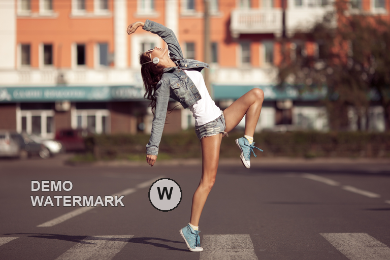
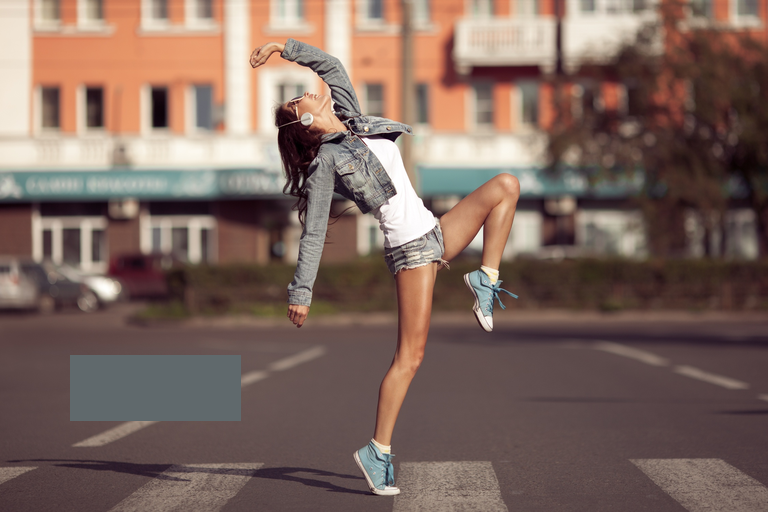
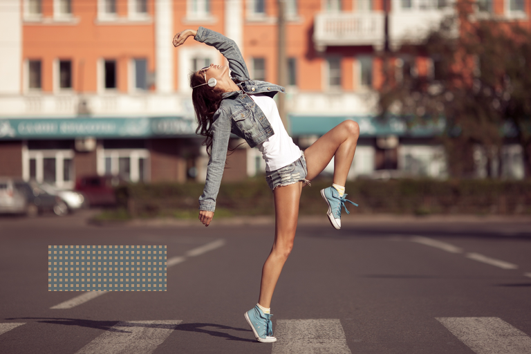
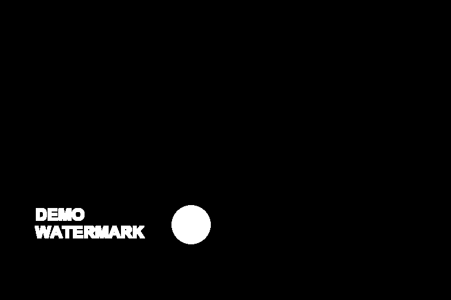

# 去水印节点参数与调参指南

这份说明对应 `workflows/qwen21_watermark.json`。先看遮罩，再看生成结果：遮罩没有覆盖水印主体、描边、白边或投影时，调提示词和 `feather` 都不能补救。

## 先按画布标题找节点

工作流画布使用下面的中文标题；括号内是源码类名，也是 ComfyUI API 工作流里的 `class_type`。安装或更新插件后重启 ComfyUI，搜索框会使用同一套中文名称。

| 画布标题 | 源码类名 | 作用 | 通常修改的参数 |
| --- | --- | --- | --- |
| **02 自动定位 / 手动改框** | `QWMDetect` | 识别文字、Logo、色块、马赛克和贴纸，或读取手动框/手绘遮罩 | `mode`、`hint`、`edit_prompt`、`expand`、`padding_ratio`、`min_confidence` |
| **03 不规则轮廓细化（SAM）** | `QWMRefineMask` | 按类型把矩形框或 SAM 轮廓变成最终遮罩 | `method`、`dilation`、`adaptive_dilation` |
| **04 裁剪并记录坐标** | `QWMPrepare` | 保留上下文、缩放局部图、记录原图坐标，可预清理遮挡 | `context_pixels`、`max_side`、`pre_inpaint`、`inpaint_radius` |
| **06 对齐 / 保色贴回** | `QWMComposite` | 把局部结果按原坐标贴回，只改遮罩内像素 | `feather`、`align`、`color_match` |
| **07 第一次修复后检查残留** | `QWMResidualDetect` | 在第一次修复范围内检查可识别的残片，最多触发一次二采 | `enabled`、`expand`、`min_confidence`、`detection_side` |
| **08 残留类型自动路由** | `QWMRefineMask` | 对残留再次选择 `box` 或 SAM | `method`、`dilation`、`adaptive_dilation` |
| **09 残留局部裁剪** | `QWMPrepare` | 为二采建立局部裁剪 | `context_pixels`、`pre_inpaint`、`inpaint_radius` |
| **10 残留定向编辑** | `TextEncodeQwenImage21` | 生成二采编辑提示词；输入由上游连线提供 | 通过 **02** 的 `edit_prompt` 追加要求 |
| **11 二采保色贴回** | `QWMComposite` | 把二采结果限制在残留遮罩内并贴回 | `feather`、`align`、`color_match` |
| **12 质量检查 / 选择最终结果** | `QWMFinal` | 自动选择一采或合格的二采，输出最终图和报告 | 无可调控件；查看 `status`、`selected_pass`、`reasons` |

`QWMRefineMask`、`QWMPrepare`、`QWMComposite` 在一采和二采中各出现一次，所以源码类名会重复；按画布上的编号区分实例。官方节点 **05 Qwen 2.1 编辑（尺寸匹配）**、**局部编辑采样**、**残留二次采样** 不属于本插件，参数名沿用 ComfyUI 原名。

## 调参顺序

1. **先修范围**：看“定位预览”和“细化遮罩预览”，确认主体、描边、白边、阴影和投影都在白色遮罩内。
2. **再修上下文**：背景线条或人物结构被重画时，增加 `context_pixels`，优先使用结构保护工作流。
3. **最后修贴回**：有轻微色差才调整 `feather`、`align`、`color_match`。`feather` 不会扩大遮罩。
4. **每次只改一个参数**，重新查看最终图和“最终质量报告”。

| 现象 | 先改什么 | 不要先改什么 |
| --- | --- | --- |
| 文字、Logo、色块边缘残留 | **02** 的 `expand`；自动检测再检查 `padding_ratio` | `feather` |
| 贴纸白边、脚或投影残留 | **03/08** 的 `dilation`；必要时开启 `adaptive_dilation` | 只调 `expand` |
| 背景改动过大 | 减小遮罩；关闭 `adaptive_dilation`；减少 `context_pixels` | 继续增大采样步数 |
| 人物、建筑结构变形 | `context_pixels=256~384`；导入 `qwen21_watermark_structure.json`；`pre_inpaint=none` | 只写负向提示词 |
| 遮罩内外有接缝或色漂 | `color_match=true`、`align=true`，再试 `feather=4~6` | 用 `feather` 覆盖漏选区域 |
| 自动误检真实招牌/衣服图案 | 提高 **02** 的 `min_confidence`，或切换 `manual_boxes` / `manual_mask` | 继续扩大 `expand` |
| 小 Logo 或低对比文字漏检 | `detection_side=1280`，在 `hint` 写位置和外观；必要时降低 `min_confidence` 后人工复核 | 盲目扩大 `context_pixels` |

## 主工作流当前值

下面是 `qwen21_watermark.json` 实际导入后的值；结构保护版只把两次 `context_pixels` 改为 `384`、`pre_inpaint` 改为 `none`。

| 画布标题 | 当前关键值 |
| --- | --- |
| **02 自动定位 / 手动改框** | `mode=auto_qwen`，`detection_side=1024`，`expand=20`，`padding_ratio=0.35`，`min_confidence=0.65` |
| **03 不规则轮廓细化（SAM）** | `method=auto`，`dilation=12`，`adaptive_dilation=true` |
| **04 裁剪并记录坐标** | `context_pixels=96`，`max_side=768`，`pre_inpaint=auto`，`inpaint_radius=5` |
| **06 对齐 / 保色贴回** | `feather=6`，`align=true`，`color_match=true` |
| **07 第一次修复后检查残留** | `detection_side=1024`，`expand=24`，`min_confidence=0.8`，`enabled=true` |
| **08 残留类型自动路由** | `method=auto`，`dilation=8`，`adaptive_dilation=false` |
| **09 残留局部裁剪** | `context_pixels=128`，`max_side=768`，`pre_inpaint=auto`，`inpaint_radius=3` |
| **11 二采保色贴回** | `feather=4`，`align=true`，`color_match=true` |

## 参数说明

### 02 自动定位 / 手动改框（`QWMDetect`）

| 参数 | 含义 | 调节建议 |
| --- | --- | --- |
| `mode` | `auto_qwen` 用 Qwen3-VL 定位；`manual_boxes` 读取 `boxes_json`；`manual_mask` 读取 `MASK` 输入 | 自动框不完整时改 `manual_boxes`；边缘复杂或贴近主体时改 `manual_mask` |
| `boxes_json` | 手动框 JSON，坐标格式为 `pixels`、`xyxy_1000` 或 `normalized` | 框必须包含完整水印和安全边；示例见下文 |
| `detection_side` | 定位图最长边 | 默认 `1024`；小字、低对比或大图可用 `1280`，显存不足降到 `768` |
| `expand` | 每个矩形框四边增加的像素 | 文字/Logo 从 `12~20` 起；色块、马赛克 `16~24`。只影响 `box` 范围 |
| `max_tokens` | 定位 JSON 的最大输出长度 | 多个水印时 `512` 足够；JSON 被截断再提高 |
| `hint` | 只给定位模型的线索 | 写“左下角灰色两行字、右下角圆形 Logo”，不要写修复要求 |
| `edit_prompt` | 给 Qwen Image 的正向编辑约束 | 写“只移除什么、恢复什么、必须保留什么”；关键结构不要只放在负向词里 |
| `padding_ratio` | 自动框按比例扩边；程序按类型限幅：文字/Logo `12%`、半透明文字 `50%`、矩形/马赛克 `12%`、贴纸最多 `25%` | 遮挡很大但框仍偏紧时增加；手动框模式不使用此比例 |
| `min_confidence` | 自动候选的最低置信度 | 默认 `0.65`；误检多时提高到 `0.75~0.85`，漏检多时降低后人工检查 |

`expand` 和 `padding_ratio` 会叠加：每边实际增加量约为 `expand + 框边长 × padding_ratio`，再受水印类型上限约束。

### 03/08 轮廓细化（`QWMRefineMask`）

| 参数 | 含义 | 调节建议 |
| --- | --- | --- |
| `method` | `auto` 按 `overlay_type` 路由；`box` 保持矩形；`sam` 对不规则贴纸调用 SAM | 文字、Logo、矩形、马赛克用 `box`；动物/人物贴纸用 `sam` |
| `sam_model` | SAM 权重文件 | 通常为 `sam_vit_b_01ec64.pth`，放在 `ComfyUI/models/sams/` |
| `device` | SAM 推理设备 | `auto`；显存不足改 `cpu`（速度明显变慢） |
| `dilation` | SAM 或手绘遮罩向外扩的基础像素 | 普通贴纸 `8~12`；白边/投影明显 `16~24`；只扩大最终遮罩 |
| `adaptive_dilation` | 按贴纸短边自动增加外扩，最大 `64px`；不规则贴纸自动使用更宽的 `12%` 短边比例，普通路径使用 `8%` | 大贴纸开启；人体、头发、建筑边缘敏感时关闭 |

`dilation` 只作用于 SAM/手绘路径；矩形框残留应调 **02** 或 **07** 的 `expand`。

### 04/09 局部裁剪（`QWMPrepare`）

| 参数 | 含义 | 调节建议 |
| --- | --- | --- |
| `context_pixels` | 遮罩四周保留的原图上下文 | 普通文字 `64~160`；人物、建筑、沙发接触面 `256~384` |
| `max_side` | 局部图送入编辑模型的最长边 | 8GB 显存用 `768`；细节复杂且显存足够用 `1024` |
| `pre_inpaint` | 预清理遮挡：`auto`、`none`、`telea`、`ns` | 文字/半透明水印 `auto` 通常为 `none`；色块、马赛克、贴纸通常为 `telea`；结构保护用 `none` |
| `inpaint_radius` | Telea/NS 预清理半径 | 色块或贴纸 `3~5`；只在 `pre_inpaint` 为 `telea/ns` 时生效 |

预清理只在局部裁剪的遮罩内执行，不会改变遮罩外原图。它不是最终贴回算法；最终贴回始终使用生成结果和遮罩。

### 06/11 对齐与贴回（`QWMComposite`）

| 参数 | 含义 | 调节建议 |
| --- | --- | --- |
| `feather` | 边缘颜色差的过渡宽度，单位为原图像素 | `4~6` 只用于缓和接缝；出现残影应扩大遮罩，`feather=0` 可用于诊断 |
| `align` | 用遮罩外上下文估计小幅平移并对齐局部结果 | 保持 `true`；报告出现 `alignment.warning` 时人工检查 |
| `color_match` | 用遮罩外配对像素做有限 RGB 校正 | 保持 `true`；只修正色漂，不会把原遮挡像素混回生成图 |

### 局部编辑采样 / 残留二次采样

这些是 ComfyUI 官方采样节点，参数名按源码显示：

| 参数 | 普通水印 | 复杂贴纸/结构保护 |
| --- | ---: | ---: |
| `steps` | `20` | `24~28`；结构困难可到 `32` |
| `cfg` | `1.0` | `1.0` |
| `sampler_name` | `euler_ancestral` | `euler_ancestral` |
| `scheduler` | `sgm_uniform` | `sgm_uniform` |
| `denoise` | `1.0` | `1.0` |
| `QwenImage21Cache.device` | `off` | `off` |

`cfg=1.0` 时，关键保留约束要写在 **02** 的 `edit_prompt`；不要只依赖负向提示词。

## 用仓库测试图片验证参数

这些素材在 GitHub 仓库内，可以直接下载后导入 `01 上传原图`。白色表示需要处理，黑色表示保留。

<table>
<tr>
<td></td>
<td></td>
<td></td>
<td></td>
</tr>
<tr>
<td align="center">文字 + Logo：`box`</td>
<td align="center">纯色色块：`box`</td>
<td align="center">矩形花纹：`box`</td>
<td align="center">手绘遮罩：`manual_mask`</td>
</tr>
</table>

| 测试素材 | 画面内容 | 建议路径与参数 | 重点观察 |
| --- | --- | --- | --- |
| [demo_watermarked.png](../samples/demo_watermarked.png) | 左下角两行文字 + 中下方圆形 `W` Logo | `auto_qwen + auto`；做范围回归时改 `manual_boxes` 并载入 `samples/demo_boxes.json`；保持 `expand=20` | “定位预览”是否覆盖文字描边和 Logo 外圈；不要用 `feather` 补漏 |
| [demo_solid.png](../samples/demo_solid.png) | 左下角纯色色块 | `manual_boxes + box`；`samples/demo_solid_boxes.json`；`expand=16~24`；`pre_inpaint=telea`；`inpaint_radius=5` | 色块四条硬边是否完整进入遮罩，背景道路纹理是否连续 |
| [demo_pattern.png](../samples/demo_pattern.png) | 左下角矩形花纹/马赛克 | `manual_boxes + box`；`samples/demo_pattern_boxes.json`；`expand=16~24`；`pre_inpaint=telea` | 规则矩形应走 `box`，不要让 SAM 扩到旁边人物或道路 |
| [demo_exact_mask.png](../samples/demo_exact_mask.png) | 文字和 Logo 的白色手绘遮罩 | `manual_mask`；`dilation=8~12`；结构敏感时 `adaptive_dilation=false` | 白色遮罩是否只覆盖叠加物；边缘残留再增加 `dilation` |
| `samples/douyin_goat_tight_boxes.json` | 贴纸紧框，包含一只小羊的主体范围 | `manual_boxes + sam`；`dilation=12`；`adaptive_dilation=true` | 检查 SAM 是否补回腿、脚、耳朵和白边；报告中查看 `dilation_ratio=0.12` |
| `samples/douyin_goat_boxes.json` | 同一贴纸的宽安全框 | `manual_boxes + sam`；用于对比紧框与宽框 | 宽框只提供候选边界，最终仍由 SAM 和安全约束决定 |

`demo_boxes.json`、`demo_solid_boxes.json`、`demo_pattern_boxes.json` 都使用原图像素坐标，直接复制到 **02** 的 `boxes_json` 即可。测试图片用于验证范围和参数，不代表模型能恢复被完全遮挡的原始像素。

## 提示词模板

### 文字和 Logo

填到 **02 自动定位 / 手动改框** 的 `edit_prompt`：

```text
只移除选区内后期叠加的文字水印和圆形 Logo。依据周围道路、阴影和纹理恢复连续背景，保持人物姿态、服装、建筑、透视、光照和构图不变。保留场景原本存在的招牌、衣服图案和真实文字，不移动任何物体。
```

### 色块和马赛克

```text
检测框内是后期叠加的矩形花纹、马赛克或纯色色块。完整移除遮挡、硬边、阴影和半透明残留，恢复被遮挡的道路、皮肤、衣物边缘和背景纹理。保持人物比例、姿态、相机和构图不变，不要输出模糊色块。
```

### 不规则贴纸

```text
检测区域内的对象是后期叠加的不规则贴纸。完整移除主体、耳朵、四肢、白色描边、半透明边缘和投影。依据周围可见的人物、服装、地面和阴影恢复连续背景，保持相机、透视、主体位置、人物身份和整体颜色不变。
```

### 人物或建筑结构保护

```text
保持人物原有坐姿、双腿位置和身体比例不变。左右大腿自然连接，不交叉、不粘连、不增加肢体。依据周围可见衣物补全连续的布料褶皱、皮肤轮廓、接触阴影和地面纹理，只恢复被遮挡结构，不新增内容。
```

负向提示词可写：`残留水印，残留贴纸，模糊涂抹，接缝，构图变化，物体移位，新增肢体，身体比例错误`。关键保留条件仍放在正向 `edit_prompt`。

## 手动框和手绘遮罩

`manual_boxes` 示例：

```json
{
  "coordinate_space": "pixels",
  "boxes": [
    {"label": "watermark", "bbox": [58, 350, 250, 418]}
  ]
}
```

`bbox` 顺序固定为 `[left, top, right, bottom]`。也支持 `xyxy_1000`（0~1000）和 `normalized`（0~1）。`manual_mask` 连接 `01 上传原图` 的 `MASK` 输出，白色为需要修复，黑色为保留。

## 结果检查与排错

先看 **12 质量检查 / 选择最终结果** 的质量报告：

- `selected_pass=0`、`status=no_overlay_detected`：没有有效遮罩，检查定位预览、`hint` 或手动模式。
- `status=completed_clean_first_pass`：一采通过数值检查和残留复检；关键素材仍应人工看左右对比。
- `status=needs_review`：查看 `reasons`、`alignment.warning`、`color.context_mae_after` 和 `boundary_jump_excess_p90`。
- `status=rejected_first_pass`：一采上下文严重失真，最终图退回原图；缩小遮罩、增加上下文或改用结构保护工作流。
- `selected_pass=2`：二采通过范围和接缝检查，但没有第三次复检，仍需人工确认。
- `outside_mask_max_difference=0`：只证明遮罩外像素没有改变，不证明遮罩内结构真实。

| 问题 | 处理 |
| --- | --- |
| 节点变红或搜索不到 | 确认仓库位于 `ComfyUI/custom_nodes/ComfyUI-Qwen-Watermark`，重启 ComfyUI 并按 `Ctrl+F5`；搜索画布标题或括号内源码类名 |
| 没有结果 | 查看 **04 裁剪并记录坐标** 的状态；`no_overlay_detected` 是空选区保护，不是采样报错 |
| 残影仍在 | 先扩大 `expand` 或 `dilation`，确认白边/投影在遮罩内；不要只增加 `feather` |
| 背景被改太多 | 缩小遮罩，关闭 `adaptive_dilation`，减少 `context_pixels`，再检查 `outside_mask_max_difference` |
| 颜色不一致 | 保持 `color_match=true`、`align=true`，尝试 `feather=4~6`；报告出现 warning 时人工检查 |
| CUDA 断言或 memory compile error | 更新仓库节点、重启 ComfyUI，保持 **07** 的 `enabled=true`；每个分区完成后会清理预取队列 |

遮挡下不存在的真实像素只能由模型生成合理内容，不能承诺像素级恢复。仅处理你拥有版权或已获授权的素材。
